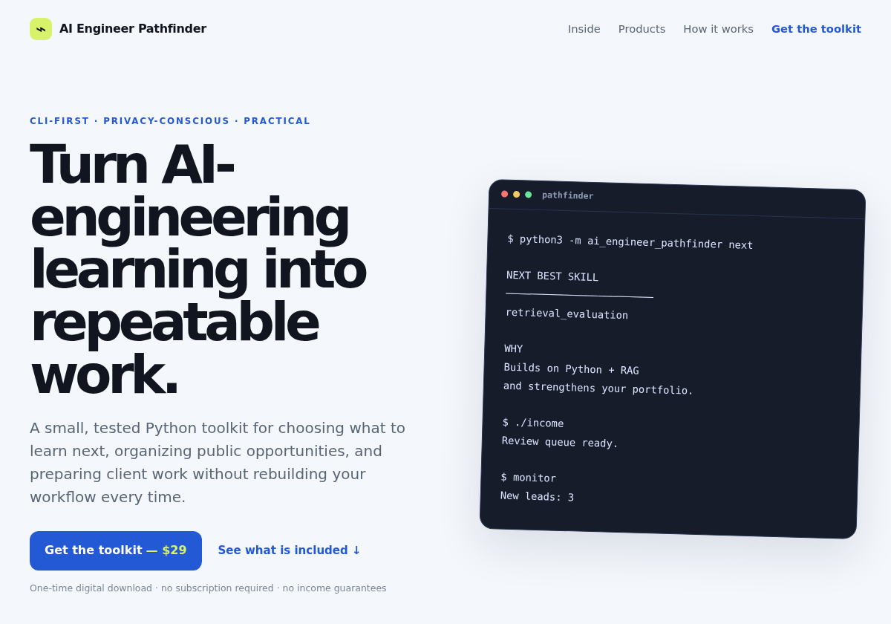

# Personal projects

I keep eleven of my hardware, accessibility, machine learning, and VR projects here. On the Genesis, I work directly with the 68000 and the video hardware. On Linux and Android, I build tools for things I use, from reading desktop text aloud to checking the devices on my network. Each link opens the source and setup notes for that project.

## Sega Genesis

| Project | What it does |
| --- | --- |
| [Cyber Shell](cyber-shell/) | A turn-based dungeon game written in 68000 assembly. |
| [Möbius demo](mobius-genesis-demo/) | Draws a rotating wireframe Möbius strip with fixed-point arithmetic and hardware sprites. |
| [Register test](genesis-register-test/) | A controller-operated test program for inspecting 68000 registers. |
| [Native runtime core](genesis-native-core/) | A C scaffold for moving parts of the SoniCkity runtime behind a stable binary interface. |

## Accessibility and VR

| Project | What it does |
| --- | --- |
| [Metal Sonic screen reader](metal-sonic-screen-reader/) | Reads accessible desktop text and clipboard changes aloud on Linux. |
| [Metal Sonic voice changer](metal-sonic-voice-changer/) | An Android speech tool for a phone-assisted Quest and VRChat setup. |
| [VRChat status badge](vrchat-status-badge/) | Adds an overhead status label to a VRChat avatar. |
| [VRChat wand](vrchat-wand/) | Builds a Unity wand with a visible trail. |

## Machine learning and developer tools

| Project | What it does |
| --- | --- |
| [LLM from scratch](llm-from-scratch/) | Trains a small language model on instruction examples and saves checkpoints for text generation. |
| [Machine Body](machine-body/) | Command-line tools for working with a Linux and Android device cluster. |
| [Pathfinder landing page](pathfinder-landing/) | A dependency-free HTML and CSS storefront for the AI Engineer Pathfinder toolkit. |

I use this terminal example on my Pathfinder landing page to show how a recommended skill appears.

I license my original contributions under the [MIT license](LICENSE). Referenced platforms, voices, characters, and third-party software retain their respective terms.
