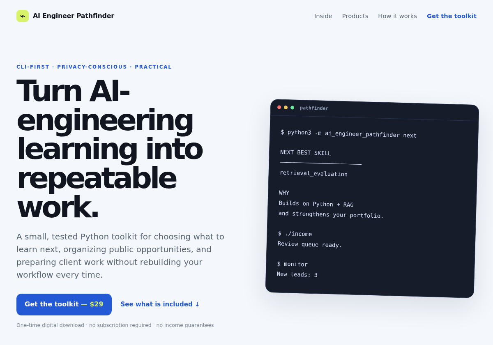

# AI Engineer Pathfinder landing page

I built this static storefront for my AI Engineer Pathfinder toolkit. I put a sample terminal session next to the description so visitors can see how a skill recommendation looks before following the product link.

## Local preview

From the collection root, run `python3 -m http.server 8787 --directory pathfinder-landing` and open `http://localhost:8787/`. The page content and product link are in [index.html](index.html).
